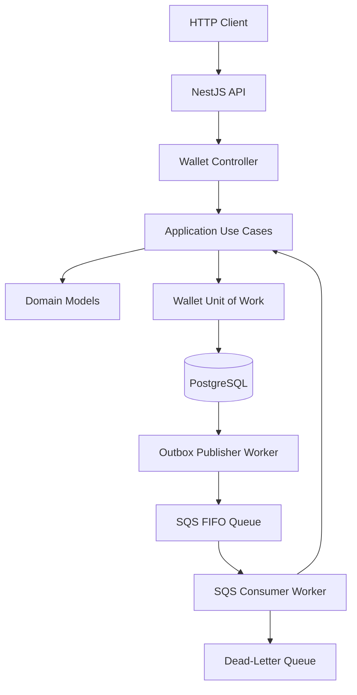

# Distributed Wallet API — Architecture

## 1. Overview

This project implements a distributed wallet and wager transaction processing API developed as an independent solution to the Jungle Gaming backend challenge.

The system is built with NestJS, TypeScript, Bun, PostgreSQL, MikroORM, and Amazon SQS, using LocalStack for local AWS service emulation.

Its primary design goals are:

- Financial consistency and integrity.
- Safe concurrent wallet mutations.
- Database-backed request and message idempotency.
- Auditable financial transaction history.
- Reliable asynchronous event publication.
- Recoverable message processing.
- Clear separation of domain, application, infrastructure, and presentation responsibilities.

The architecture combines Domain-Driven Design (DDD), Ports and Adapters (Hexagonal Architecture), transactional persistence, and the Inbox and Outbox messaging patterns.

## 2. Technology Stack

| Component | Technology |
|---|---|
| Runtime | Bun |
| Language | TypeScript |
| Framework | NestJS |
| ORM | MikroORM |
| Database | PostgreSQL 17 |
| Messaging | Amazon SQS |
| Local AWS environment | LocalStack |
| Containerization | Docker / Docker Compose |
| Testing | Bun Test |
| Static analysis | Oxlint |

## 3. Architectural Design

The application is organized into four main layers.

### 3.1 Domain Layer

Location: `src/domain`

Contains the core business rules and domain models, independent of external infrastructure.

Main components:

- `Wallet`: balance management, debit and credit operations, and balance validation.
- `Money`: monetary value representation and arithmetic.
- `WagerTransaction`: transaction lifecycle, status transitions, references, and reversal rules.
- `WalletLedgerEntry`: financial movement records.

Monetary calculations use integer minor-unit string arithmetic instead of JavaScript floating-point calculations.

The domain layer does not depend on NestJS, MikroORM, PostgreSQL, or SQS.

### 3.2 Application Layer

Location: `src/application`

Coordinates business operations through use cases and defines ports for infrastructure dependencies.

Main use cases:

- `CreateWalletUseCase`
- `GetWalletUseCase`
- `GetWalletLedgerUseCase`
- `ProcessWagerTransactionUseCase`
- `ReconcileWalletUseCase`

The application layer defines repository contracts and the `WalletUnitOfWork` abstraction.

This keeps business orchestration independent of concrete persistence implementations.

### 3.3 Infrastructure Layer

Location: `src/infrastructure`

Provides concrete implementations for persistence, messaging, and operational concerns.

Includes:

- MikroORM entities and repositories.
- PostgreSQL migrations.
- Transaction-scoped Unit of Work implementation.
- Inbox and Outbox persistence.
- SQS transaction consumer.
- Outbox publisher service.
- Structured HTTP logging and request context.

### 3.4 Presentation Layer

Location: `src/presentation`

Contains the HTTP interface and application error translation.

The HTTP controller receives requests, invokes application use cases, and returns API responses.

The application error filter centralizes the translation of application errors into HTTP responses.

## 4. High-Level Architecture

The main application flow is represented below.



The HTTP API, SQS consumer, and Outbox publisher operate as separate application processes.

PostgreSQL is the source of truth for financial state and message-processing records.

## 5. Persistence Model

PostgreSQL stores the authoritative wallet state and financial history.

Main tables:

| Table | Responsibility |
|---|---|
| `wallets` | Wallet identity, player, currency, balance, and version |
| `wager_transactions` | Financial transactions and lifecycle state |
| `wallet_ledger_entries` | Financial movement history |
| `inbox_messages` | Consumed-message deduplication |
| `outbox_events` | Events awaiting asynchronous publication |

Database-level protections include unique constraints and indexes for transaction identifiers, idempotency keys, ledger references, Inbox identifiers, Outbox event identifiers, and duplicate reversal prevention.

Foreign keys and check constraints provide additional persistence-level integrity protections.

The database is the authoritative source for financial operations; message brokers are not used as the source of wallet balances.

## 6. Monetary Representation and Financial Integrity

The `Money` value object validates monetary amounts and currency codes.

Amounts are internally represented using integer minor-unit strings. Monetary arithmetic avoids JavaScript `number` floating-point calculations.

API and persistence boundaries use decimal strings.

Wallet debits are validated by the domain model. An insufficient balance rejects the operation rather than allowing a negative balance.

Successful financial mutations persist the wallet update, transaction record, ledger entry, and corresponding Outbox event within the same database transaction.

## 7. Wager Transaction Processing

The `ProcessWagerTransactionUseCase` coordinates financial operations through the Unit of Work abstraction.

The processing sequence is:

1. Normalize and validate the incoming command.
2. Parse and validate the monetary amount.
3. Calculate a SHA-256 payload fingerprint.
4. Check the idempotency key.
5. Check the provider's external transaction identifier.
6. Acquire a pessimistic write lock on the target wallet.
7. Recheck idempotency and external transaction identifiers after acquiring the lock.
8. Create or resume the wager transaction.
9. Validate transaction references and reversal rules.
10. Apply the debit or credit through the Wallet domain model.
11. Persist the wallet, transaction, and ledger entry.
12. Persist the corresponding Outbox event.
13. Commit the database transaction.

All database writes in this flow share the same Unit of Work transaction.

### Supported transaction types

- `OPENING`
- `BET`
- `WIN`
- `LOSS`
- `REFUND`
- `ROLLBACK`

`OPENING` is an internal wallet initialization operation and is not accepted through the SQS wager consumer.

Refunds and rollbacks require a valid reference transaction. Duplicate reversal protection is enforced through application validation and a PostgreSQL partial unique index.

Transactions arriving before their required reference can be stored with `PENDING_REFERENCE` status and resumed when the reference becomes available.

## 8. Concurrency and Idempotency

### 8.1 Pessimistic Locking

Wallet mutations use PostgreSQL pessimistic write locking through MikroORM.

This serializes competing financial mutations targeting the same wallet and ensures that balance validation occurs against the transactionally protected state.

### 8.2 Optimistic Version Checks

Wallet updates also verify the expected version.

The update is conditional on the previous version. A version conflict is raised if the wallet has already been modified by another operation.

The combination of pessimistic locking and version checks provides additional protection against conflicting updates.

### 8.3 Request Idempotency

Idempotency keys and provider transaction identifiers are persisted in PostgreSQL.

A repeated request with the same idempotency key and matching payload returns the existing transaction.

Reusing the same key with a different payload results in a conflict.

These mechanisms do not rely on in-memory state and support processing across multiple application instances.

## 9. Financial Ledger and Reconciliation

The ledger records successful financial movements with:

- Wallet identifier.
- Transaction identifier.
- Direction.
- Amount and currency.
- Balance before the movement.
- Balance after the movement.
- Creation timestamp.

A database uniqueness constraint prevents multiple ledger entries for the same transaction.

The `ReconcileWalletUseCase` compares the stored wallet balance against the balance reconstructed from its ledger entries.

The reconciliation endpoint is:

`GET /api/v1/wallets/{walletId}/reconciliation`

The ledger provides an auditable record of financial movements and supports balance verification.

## 10. Inbox Pattern — Incoming Messages

The SQS consumer processes incoming wager transaction messages.

Before applying the financial operation, the application registers the message in the Inbox table using:

- Consumer identifier.
- Message identifier.
- Payload hash.

The database enforces uniqueness for the consumer/message identifier.

Inbox registration, financial processing, and processed-message marking are coordinated through the same Unit of Work transaction.

This prevents a message from being marked as successfully processed independently of its financial database operation.

Duplicate messages are identified and acknowledged without applying the financial operation again.

## 11. Outbox Pattern — Outgoing Events

Financial operations persist their corresponding Outbox events in the same database transaction as wallet, transaction, and ledger changes.

The independent Outbox publisher worker:

1. Finds unpublished events eligible for delivery.
2. Claims events using PostgreSQL `FOR UPDATE SKIP LOCKED`.
3. Uses a time-limited lease to coordinate competing publishers.
4. Publishes events to SQS.
5. Marks successfully published events.
6. Schedules failed events for retry using exponential backoff.

The delivery model is **at-least-once**, not exactly-once.

If a message is successfully sent but the publisher crashes before marking the event as published, the same event may be delivered again.

Downstream consumers must therefore implement idempotent processing.

## 12. SQS Consumer and Failure Handling

The transaction consumer uses an SQS FIFO queue and a separate dead-letter queue.

The consumer supports:

- Long polling.
- Configurable visibility timeout.
- Message validation.
- Duplicate-message handling.
- Retry with exponential visibility delays.
- Maximum receive count.
- Dead-letter routing for invalid or repeatedly failing messages.

Messages are acknowledged after successful processing or when classified as terminal.

The SQS consumer and Outbox publisher run independently from the HTTP API process.

## 13. HTTP API

Base URL:

`http://localhost:3000/api/v1`

Implemented operations include:

| Method | Endpoint | Purpose |
|---|---|---|
| GET | `/` | Service status |
| POST | `/wallets` | Create a wallet |
| GET | `/wallets/{walletId}` | Retrieve a wallet |
| GET | `/wallets/{walletId}/ledger` | Retrieve wallet ledger |
| GET | `/wallets/{walletId}/reconciliation` | Reconcile wallet balance |
| POST | `/transactions` | Process a wager transaction |
| GET | `/transactions/{transactionId}` | Retrieve a transaction |

The transaction endpoint requires an `Idempotency-Key` HTTP header.

The application also exposes operational health endpoints:

- `GET /health/live`: indicates whether the application process is alive.
- `GET /health/ready`: checks database readiness.

The readiness endpoint currently verifies PostgreSQL connectivity. It should not be interpreted as a complete dependency health check for SQS.

## 14. Local Development and Runtime

Docker Compose provides the following services:

- PostgreSQL.
- LocalStack.
- HTTP API.
- Outbox publisher worker.
- SQS transaction consumer.

Start the environment with:

```bash
docker compose up --build
```

Default local service ports:

| Service | Port |
|---|---:|
| HTTP API | 3000 |
| PostgreSQL | 5433 |
| LocalStack | 4566 |

Environment variables are configured through `.env`, using `.env.example` as a reference.

## 15. Testing and Validation

The project uses Bun Test for automated tests.

The latest recorded validation included:

- 76 passing tests.
- 0 failing tests.
- 169 assertions.
- 7 test files.
- Successful production build.

Coverage includes domain behavior, application transaction scenarios, HTTP health endpoints, and Outbox publisher behavior.

A manual LocalStack smoke test also exercised message processing, duplicate delivery, malformed-message handling, and message routing.

The duplicate-delivery validation confirmed that processing the same wager message again did not create a second financial debit or additional ledger entry.

These results do not constitute a complete multi-instance concurrency or production crash-recovery test suite.

## 16. Observability

The application includes structured HTTP logging and request context propagation.

Correlation identifiers are used to associate processing activity across application components